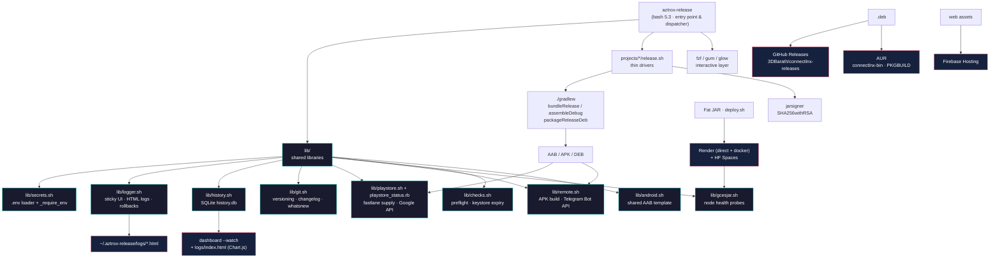

# aztrox-release — Unified Release CLI

> **The local CI/CD engine for Aztrox Inc.** One Bash entry point that builds, signs, and ships every Aztrox product — Android AABs to Google Play, desktop DEBs/MSIs to GitHub + AUR, web to Firebase, and JARs to Render/HF Spaces — with atomic rollbacks, SQLite history, and live terminal dashboards. Designed for manual triggers on CachyOS/Arch.

[](https://www.gnu.org/software/bash/)
[](#prerequisites--local-dev-quickstart)
[](https://docs.fastlane.tools/)
[](https://www.shellcheck.net/)
[](#database--storage)
[](#)

---

## Table of Contents

- [Problem Statement & Solution](#problem-statement--solution)
- [Architecture & Data Flow](#architecture--data-flow)
- [Module / Directory Structure](#module--directory-structure)
- [CLI Reference](#cli-reference)
- [Database & Storage](#database--storage)
- [Prerequisites & Local Dev Quickstart](#prerequisites--local-dev-quickstart)
- [Configuration & Env Variables](#configuration--env-variables)
- [CI/CD & Deployment](#cicd--deployment)
- [Troubleshooting](#troubleshooting)
- [Detailed Docs](#detailed-docs)

---

## Problem Statement & Solution

**Bottleneck:** Aztrox ships 9 products across 4 distribution surfaces (Google Play, GitHub Releases + AUR, Firebase Hosting, Render/HF Spaces) from 6+ private repos. Each product had its own ad-hoc Gradle/fastlane incantation — version bumping, signing, track selection, and rollback were manual and inconsistent. Cold CIs on Render and staged-rollout mistakes caused silent versionCode conflicts.

**Solution:** `aztrox-release` collapses every pipeline into a single `./aztrox-release` binary. Shared libraries (`lib/`) own cross-cutting concerns — Play Store conflict detection, HTML logging, SQLite history, atomic LIFO rollbacks, sticky progress UI, Telegram distribution — while thin project drivers (`projects/*/release.sh`) declare only what differs (Gradle file, AAB path, keystore). The result is a local, non-interactive-safe CLI that can also run fully interactive via `fzf`/`gum`/`glow`.

**Target personas:**

| Persona | Job to be done |
|---|---|
| Solo founder / release engineer | Cut a Play Store release in one command with safe versionCode auto-bump |
| KMP / Android developer | `run` a debug build on device or `remote run` an APK to Telegram without leaving the terminal |
| Ops | `health` + `server-status` + `dashboard --watch` for drift, expiry, and node health at a glance |

---

## Architecture & Data Flow



**Release lifecycle (happy path):**

```
preflight (health + git clean + branch) → versioning (select_version + suggest_next_version)
  → conflict check (Play Store versionCode via fastlane)
  → gradle versioning (sed + rollback registration)
  → parallel builds (.deb + .aab via log_exec_bg) + prepare whatsnew (micro + glow)
  → wait + sign (jarsigner) → upload (fastlane supply / gh release / AUR push / firebase deploy)
  → git finalization (commit → tag → push) → SQLite success + HTML log + notify-send
                    ↘ on failure → LIFO rollbacks → open log → critical notification
```

### Tech Stack by Layer

| Layer | Technology | Source |
|---|---|---|
| **Runtime** | Bash 5.3 (`set -euo pipefail`) | `bash --version` |
| **Build** | Gradle Wrapper (`./gradlew`) per project, `godot --headless` for Chess | `projects/*/release.sh`, `lib/remote.sh:279-293` |
| **Signing** | `jarsigner` / `keytool` (JDK 17 — `jdk17-openjdk`) | `lib/checks.sh:85`, `lib/android.sh:103` |
| **Distribution — Android** | `fastlane supply` + `google/apis/androidpublisher_v3` (Ruby) | `lib/playstore.sh`, `lib/playstore_status.rb` |
| **Distribution — Desktop** | `gh` (GitHub CLI), `makepkg --printsrcinfo`, `git push` to AUR | `projects/connectlnxApp/release.sh:222-271` |
| **Distribution — Web** | `firebase-tools` (`firebase deploy`) | `projects/connectlnxApp/release.sh:292` |
| **Distribution — Remote** | Telegram Bot API (`curl` → `sendDocument`) | `lib/remote.sh:101-186` |
| **Server deploy** | `deploy.sh` in `GCESJAR_DIR` + `curl` health probes | `aztrox-release:565`, `lib/gcesjar.sh` |
| **Persistence** | SQLite (`~/.aztrox-release/history.db`), HTML logs (`~/.aztrox-release/logs/`) | `lib/history.sh`, `lib/logger.sh` |
| **TUI / UX** | `fzf` > `gum` > `select` fallback, `glow` for markdown, `notify-send` + `paplay`, `adb` | `aztrox-release:94-105`, `lib/colors.sh`, `lib/logger.sh` |
| **Lint** | ShellCheck 3.50.6 (`disable=SC1090,SC1091`) | `.shellcheckrc` |

> **Package-manager detection:** This is a Bash/CachyOS project — not Node, Python, Go, or Rust. There are no `package-lock.json` / `pnpm-lock.yaml` / `Cargo.toml` / `pyproject.toml` lockfiles. Install system deps with `pacman` (Arch/CachyOS), Ruby gems with `gem`, and build each Android/KMP app with its own `./gradlew` wrapper (never bare `gradle`). The optional Node dep is `firebase-tools` (`npm install -g firebase-tools`) only if you ship the ConnectLnx web target.

---

## Module / Directory Structure

```
aztrox-release/
├── aztrox-release              # ← CLI entry point: arg parsing, dispatch, cleanup trap,
│                               #   interactive picker, dashboard, run/remote wrappers
├── .env.template               # Sanitized template — copy to .env
├── .env                        # (gitignored) real secrets & absolute project paths
├── .shellcheckrc               # disable=SC1090,SC1091
├── .gitignore                  # .env, *.log, *.bak, .opencode/
│
├── lib/                        # Shared libraries (sourced by entry point + drivers)
│   ├── colors.sh               # Palette, show_banner, log_* helpers, glow_md, confirm
│   ├── secrets.sh              # Sources .env with `set -a`, _require_env validator
│   ├── checks.sh               # check_deps, check_git_*, check_keystore_expiry
│   ├── git.sh                  # get_current_version, suggest_next_version,
│   │                           # select_version, generate_changelog, prepare_whatsnew
│   ├── logger.sh               # HTML logs, sticky header UI, log_exec/bg, wait_exec_bg,
│   │                           # register_rollback, update_log_index (Chart.js)
│   ├── history.sh              # SQLite schema + log_release_*, show_history (fzf)
│   ├── playstore.sh            # upload_to_playstore, select_track, versionCode bump
│   ├── playstore_status.rb     # Ruby: Android Publisher API → Play Store dashboard
│   ├── android.sh              # android_release() template (3 → 1 for thin drivers)
│   ├── gcesjar.sh              # check_gcesjar_health (Render + HF Spaces probes)
│   ├── remote.sh               # build_project_apk, send_telegram_document, remote_run_app
│   └── open.sh                 # open_project → antigravity -n
│
├── projects/                   # One driver per product (sourced, not standalone)
│   ├── gceshostel/release.sh   # Full pipeline: gradle.properties + server-change gate
│   ├── connectlnxApp/release.sh# Multi-target: release branch, .deb+.aab parallel,
│   │                           # GitHub Release, AUR, Play Store, Firebase
│   ├── twoplayer/release.sh    # Thin wrapper → lib/android.sh
│   ├── chessgame/release.sh    # Godot: export_presets.cfg versioning + godot --headless
│   ├── freshola/release.sh     # Thin → android.sh (:androidApp:bundleRelease)
│   ├── bloodline/release.sh    # Thin → android.sh (:app:assemble*)
│   ├── extracam/release.sh     # Thin → android.sh (CameraX/MediaCodec)
│   ├── smet/release.sh         # Placeholder (Smart Expense Tracker)
│   └── uilab/release.sh        # Showroom — local/remote only, no Play Store
│
├── completions/
│   ├── aztrox-release.bash     # Bash completion + fzf picker on ambiguous TAB
│   ├── _aztrox-release         # Zsh completion
│   └── aztrox-release.fish     # Fish completion
│
└── aztrox-docs/                # Deep-dive docs (not duplicated here)
    ├── AZTROX_RELEASE.md       # Pipeline workflows per project
    ├── PROJECT_MAP.md          # Repo map, deployment targets, signing architecture
    ├── CLI_REFERENCE.md        # Flag-by-flag CLI reference
    ├── DEVELOPER_GUIDE.md      # Adding a new project, rollback system
    ├── TROUBLESHOOTING.md      # Common errors & fixes
    └── TODO.md                 # Roadmap & blockers
```

**Key design choices:**

- **Composition over duplication** — `lib/android.sh:android_release` is the single AAB template. Thin drivers (`twoplayer`, `freshola`, `bloodline`, `extracam`) set 7 vars and call it. Only `gceshostel`, `connectlnxApp`, and `chessgame` carry custom logic.
- **Sticky UI is hardware-scroll-region based** — `lib/logger.sh` uses `ESC [r` to pin a 11-line dashboard while logs stream below. Paused during `fzf`/`gum`/`micro` prompts to avoid cursor fights.
- **No lockfile repo** — versioning is git-tag-driven (`v*` tags, `--sort=-v:refname`) plus `gradle.properties` / `export_presets.cfg` mutation with `.bak` + LIFO rollback.

---

## CLI Reference

> All commands are invoked as `./aztrox-release <command> [args] [--dry-run] [--skip-tests] [--skip "step1,step2"]`. With no args and a TTY, an `fzf`/`gum` interactive picker launches. Global flags are parsed before dispatch (`aztrox-release:296-315`).

### Release pipelines

| Command | Target | What it does |
|---|---|---|
| `gceshostel` | Google Play (`com.barath.gceshostel`) | `gradle.properties` version bump → server-change gate → `bundleRelease` (bg) + `prepare_whatsnew` → `jarsigner` → `fastlane supply` → `git commit/tag/push` |
| `connectlnxApp` / `connectlnx` | Play + GitHub + AUR + Firebase | Release branch `release/v*` → `gradle.properties` bump → parallel `.deb` + `.aab` → sign → `gh release create` (connectlnx-releases) → PKGBUILD+`.SRCINFO` → AUR push → Play upload → `website/release.sh` + `firebase deploy` → merge to `main` |
| `twoplayer` | Google Play (`org.aztrox.multigame`) | Thin `android.sh` — `bundleRelease` → sign → Play |
| `chessgame` | Google Play (`org.aztrox.chessgame`) | Godot: `export_presets.cfg` version bump → `godot --headless --export-release` → `jarsigner` → Play |
| `freshola` | Google Play (`org.freshola.app`) | Thin `android.sh` — `:androidApp:bundleRelease` |
| `bloodline` | Google Play (`com.barath.bloodline`) | Thin `android.sh` — `:app:bundleRelease` |
| `extracam` | Google Play (`org.mystrox.extracam`) | Thin `android.sh` |
| `smet` | — | Placeholder; logs TODOs |
| `uilab` | — | Showroom only — no release; use `run` / `remote run` |
| `gcesjar "commit message"` | Render + HF Spaces | Passthrough to `$GCESJAR_DIR/deploy.sh "msg"` (Fat JAR) |
| `all` | — | Sequential: `gceshostel` + `gcesjar` + `connectlnxApp` |

### Development & distribution

| Command | Description |
|---|---|
| `run {project}` | Build `installDebug` (or `:composeApp:installDebug`) for the detected ABI (`adb shell getprop ro.product.cpu.abi`, defaults `arm64-v8a`) and `am start` the launcher activity. Handles `INSTALL_FAILED_UPDATE_INCOMPATIBLE` by offering `adb uninstall`. Project `connectlnx` opens a `tmux` split (device + JVM). `gcesjar` runs `server:bootRun`. `chessgame` uses `godot --headless --export-debug`. |
| `remote run {project}` / `remote {project}` | Build APK (`assembleDebug` by default) and `curl` it to Telegram `sendDocument` with an HTML caption (version, branch, commit, size, timestamp). Flags: `--release`, `--debug`, `--abi <abi>`, `--all-arch`/`--fat`. Prompts to save `TELEGRAM_BOT_TOKEN`/`TELEGRAM_CHAT_ID` to `.env` if missing. |
| `jvmrun {project}` / `connectlnxJvm` | `(cd $CONNECTLNXAPP_DIR && ./gradlew :composeApp:run)` |
| `test {project}` | `./gradlew test` (or `:shared:allTests` for FreshOla) |
| `open [{project}]` | `antigravity -n <dir>` — picker if no arg |

### Inspection & management

| Command | Description |
|---|---|
| `status [project] [track]` | No arg: local versions table (`gradle` vs `tag` sources) via `glow`. With arg: `show_playstore_status` via Ruby API (`internal`/`alpha`/`beta`/`production`/`all`). |
| `dashboard [--watch]` | Live TUI — local versions, unreleased commits, last 5 releases from SQLite, health summary. `--watch` loops every 4s. Rendered through `glow`. |
| `server-status` | Probes 3 GCESJAR nodes (`gcesjar.onrender.com`, `gcesjar-fast.onrender.com`, `3dbarath-gcesjar.hf.space` → `/api/debug/version`) and compares to local `gradle.properties` version |
| `health` | `check_deps` (git, jarsigner, keytool, gh, sqlite3, firebase, fastlane, xdg-open, adb, curl) + `_require_env` for every `*_DIR`/`*_PACKAGE`/`*_KEYSTORE` + `check_dir_exists` + `check_file_exists` for Play JSON + `check_keystore_expiry` per product + Telegram masking |
| `history [clear]` / `history --plain [n]` | `history`: fzf browser with HTML log preview (or plain table if no TTY/`fzf`); `--plain` prints `show_history` table + per-project avg/fastest/slowest stats |
| `unreleased` | Commits since last `v*` tag per project (`GCESHostel`, `ConnectLnx`, `GCESJAR:server/`, `SMET`, `FreshOla`, `BloodLine`, `ExtraCam`, `TwoPlayer`, `ChessGame`) |
| `diff {project}` | `git log TAG..HEAD --oneline` + `git diff --stat` since last tag; fzf commit browser with `git show` preview when interactive |
| `compare {project} v1 v2` | `git diff v1..v2 --stat` + `git log v1..v2 --oneline`; picks tags via fzf if args omitted |
| `sshify {project}` | Converts `origin` from `https://github.com/...` to `git@github.com:...` (GitHub only) |
| `completions [bash|zsh|fish|install]` | Cats or installs shell completions (`install` detects `$SHELL`) |

### Global flags

| Flag | Effect |
|---|---|
| `--dry-run` | No `git push`, no `fastlane supply`, no signing, no Firebase/AUR deploy; versionCode forced to `999` |
| `--skip-tests` | Bypasses `./gradlew test` phases |
| `--skip "step1,step2"` / `--skip-steps` | Skip named pipeline steps (checked via `should_skip_step`); bare `--skip`/`--skip-steps` opens interactive multi-select (`fzf -m`) |
| `--track a,b` | Play Store track(s): `internal,alpha,beta,production`. Multi-select uploads once to the lowest track and promotes to the highest (e.g. `--track internal,production`) |

> [!TIP]
> Try `dashboard --watch` for a 4-second live refresh, or run with no args for the full interactive picker (`fzf` → `gum` → `select` fallback).

---

## Database & Storage

### SQLite — `~/.aztrox-release/history.db`

Created on first write (`lib/history.sh:db_init`). Two tables:

```sql
CREATE TABLE releases (
  id          INTEGER PRIMARY KEY AUTOINCREMENT,
  project     TEXT NOT NULL,          -- e.g. gceshostel, connectlnx, chessgame
  version     TEXT NOT NULL,          -- semver without v prefix
  track       TEXT,                   -- internal / alpha / beta / production
  status      TEXT DEFAULT 'running', -- running | success | failed
  start_time  DATETIME DEFAULT CURRENT_TIMESTAMP,
  end_time    DATETIME,
  duration    INTEGER,                -- seconds (strftime('%s','now') - start_time)
  log_file    TEXT                    -- absolute path to HTML log
);

CREATE TABLE release_steps (
  id          INTEGER PRIMARY KEY AUTOINCREMENT,
  release_id  INTEGER NOT NULL REFERENCES releases(id),
  step_name   TEXT NOT NULL,
  status      TEXT DEFAULT 'success',
  updated_at  DATETIME DEFAULT CURRENT_TIMESTAMP
);
```

**Key flows:**

- `log_release_start(project, version, track)` → `INSERT` + `last_insert_rowid()` — caller stores `RELEASE_ID`.
- `log_step_complete(release_id, step_name)` — called by `next_step` for each successful step; enables `find_resumable_release` + `get_completed_steps` to skip completed steps on retry.
- `find_resumable_release(project, version)` — returns the latest non-`success` row for that project+version; caller offers `confirm "Resume?"`.
- `log_release_end(id, status, log_file)` — sets `end_time`, computes `duration`, writes `log_file` path.
- `show_history` / `show_history_interactive` — plain table + per-project stats footer, or `fzf` picker with `sed 's/<[^>]*>//g' | glow` preview and `xdg-open` on select.

Wipe interactively with `history clear` or surgically via:

```bash
sqlite3 ~/.aztrox-release/history.db "DELETE FROM releases WHERE project='freshola' AND version='1.0.0';"
```

### HTML Logs — `~/.aztrox-release/logs/`

- `init_html_log(project, version)` creates `logs/<project>-<version>-<epoch>.html` with a sticky toolbar and `Copy Plain Log` button (`logger.sh:41-76`).
- Every `log_*` call appends an escaped `log-entry` div; `log_exec`/`log_exec_bg` embed stripped command output in `exec-block` pres.
- `close_html_log` + `update_log_index` on exit generates `logs/index.html` — 5 metric cards (total/success/failed/rate/avg) + 3 Chart.js charts (weekly releases, success doughnut, avg duration by project) + sortable file table.

---

## Prerequisites & Local Dev Quickstart

### Prerequisites

| Requirement | Version / Notes | Check |
|---|---|---|
| **OS** | CachyOS / Arch Linux (pacman) | `cat /etc/os-release` |
| **Bash** | 5.x (`set -euo pipefail`, `BASH_REMATCH`) | `bash --version` — pinned 5.3 in this repo |
| **JDK** | 17 (`jdk17-openjdk` for `jarsigner`/`keytool`) | `jarsigner -version` |
| **Git** | any recent | `git --version` |
| **Android SDK** | `adb` on `$PATH` for `run`/`remote` | `adb --version` |
| **Ruby + fastlane** | fastlane 2.232.2 (needs `erb` gem on Ruby 3.4; see Troubleshooting) | `fastlane --version` |
| **SQLite** | `sqlite3` for history & dashboard | `sqlite3 --version` |
| **GitHub CLI** | `gh` + `gh auth login` (ConnectLnx GitHub Releases, `sshify`) | `gh --version` |
| **Firebase CLI** | `firebase-tools` (Node — `npm install -g firebase-tools`, only for ConnectLnx web) | `firebase --version` |
| **Godot** | `godot` on `$PATH` (only for `chessgame` / `run chessgame`) | `godot --version` |
| **Optional TUI** | `fzf`, `gum`, `glow`, `micro` (`$EDITOR`), `xdg-utils`, `curl`, `jq` | `fzf --version`, `glow --version` |

> Each Android/KMP product builds with its **own Gradle Wrapper** — always `./gradlew` (with `-Dorg.gradle.caching=true -Dorg.gradle.parallel=true --console=rich`), never bare `gradle`. Wrapper versions are pinned inside each project repo, not here.

### Quickstart (clone → first `health` → first `run`)

```bash
# 1. Clone
git clone git@github.com:3DBarath/aztrox-release.git
cd aztrox-release

# 2. System deps (CachyOS/Arch)
sudo pacman -S git jdk17-openjdk github-cli sqlite xdg-utils curl jq \
               android-tools fzf glow ruby

# 3. Ruby / fastlane (Ruby 3.4 note: erb was extracted from stdlib)
gem install erb
gem install fastlane   # pinned 2.232.2 in this workspace

# 4. Optional — only if you ship ConnectLnx web
npm install -g firebase-tools
firebase login

# 5. Optional — richer TUI
sudo pacman -S gum          # or: go install github.com/charmbracelet/gum@latest
# micro is $EDITOR for "What's New" — install if you don't have it:
sudo pacman -S micro

# 6. Authenticate GitHub CLI
gh auth login

# 7. Configure secrets & paths (NEVER commit .env)
cp .env.template .env
nano .env   # fill absolute paths, keystore aliases/passwords, tokens

# 8. Make executable
chmod +x aztrox-release
chmod +x projects/*/release.sh

# 9. Verify
./aztrox-release health
./aztrox-release dashboard
./aztrox-release status

# 10. Try a no-side-effect run
./aztrox-release gceshostel --dry-run
./aztrox-release diff gceshostel
./aztrox-release unreleased

# 11. Device run (needs adb device)
./aztrox-release run gceshostel

# 12. Install shell completions (optional)
./aztrox-release completions install
# or manually:
# bash: source completions/aztrox-release.bash >> ~/.bashrc
# zsh:  fpath=(/path/to/completions $fpath) && autoload -Uz compinit && compinit
# fish: cp completions/aztrox-release.fish ~/.config/fish/completions/
```

**Common one-liners:**

```bash
./aztrox-release --help
./aztrox-release test gceshostel
./aztrox-release diff connectlnxApp | glow
./aztrox-release compare gceshostel v1.2.0 v1.3.0
./aztrox-release remote run extracam --release --abi all
./aztrox-release dashboard --watch
./aztrox-release history --plain 50
```

---

## Configuration & Env Variables

All runtime config is read from `.env` in the repo root (`lib/secrets.sh` does `set -a; source .env; set +a` and validates with `_require_env`). Copy `.env.template` and fill it — never commit `.env` (already in `.gitignore`).

> Values below use the **sanitized placeholders from `.env.template`**. See that file for the canonical list. Paths must be **absolute**.

| Variable | Required | Default | Description |
|---|---|---|---|
| `PLAY_SERVICE_ACCOUNT_JSON` | Yes (Play releases) | `~/.secrets/play-service-account.json` | Google Play service-account JSON for `fastlane supply` & `playstore_status.rb` (needs Release Manager in Play Console) |
| `KEYSTORE_DIR` | No | `~/.android/keystore` | Base dir for all `.jks` files |
| `GCESHOSTEL_DIR` | Yes | `/path/to/GCESHostel` | GCESHostel repo root (contains `gradle.properties`, `app/build.gradle.kts`) |
| `GCESHOSTEL_KEYSTORE` | Yes (gceshostel) | `$KEYSTORE_DIR/gceshostel.jks` | Upload keystore (JKS) |
| `GCESHOSTEL_KEY_ALIAS` | Yes | `your-alias-here` | Key alias |
| `GCESHOSTEL_STORE_PASS` | Yes | `your-store-password` | Keystore password |
| `GCESHOSTEL_KEY_PASS` | Yes | `your-key-password` | Key password |
| `GCESHOSTEL_PACKAGE` | Yes | `com.barath.gceshostel` | Play package name |
| `GCESJAR_DIR` | Yes (gcesjar/server-status) | `/path/to/GCESHostel/server` | Where `deploy.sh` lives; GCESJAR health probes compare its `gradle.properties` version |
| `CONNECTLNXAPP_DIR` / `CONNECTLNX_DIR` | Yes | `/path/to/ConnectLnxKMP` | ConnectLnx KMP repo root |
| `CONNECTLNXAPP_KEYSTORE` / `CONNECTLNX_KEYSTORE` | Yes (connectlnx) | `$KEYSTORE_DIR/connectlnx.jks` | Upload keystore |
| `CONNECTLNXAPP_KEY_ALIAS` / `CONNECTLNX_KEY_ALIAS` | Yes | `your-alias-here` | Alias |
| `CONNECTLNXAPP_STORE_PASS` / `CONNECTLNX_STORE_PASS` | Yes | `your-store-password` | Store pass |
| `CONNECTLNXAPP_KEY_PASS` / `CONNECTLNX_KEY_PASS` | Yes | `your-key-password` | Key pass |
| `CONNECTLNXAPP_PACKAGE` / `CONNECTLNX_PACKAGE` | Yes | `org.barath.connectlnxkmp` | Play package |
| `TWOPLAYER_DIR` | Yes (twoplayer) | `/path/to/XOMultiplayer` | Two Player repo |
| `TWOPLAYER_KEYSTORE` | Yes | `$KEYSTORE_DIR/twoplayer.jks` | JKS |
| `TWOPLAYER_KEY_ALIAS` | Yes | `your-alias-here` | Alias |
| `TWOPLAYER_STORE_PASS` | Yes | `your-store-password` | Store pass |
| `TWOPLAYER_KEY_PASS` | Yes | `your-key-password` | Key pass |
| `TWOPLAYER_PACKAGE` | Yes | `org.aztrox.multigame` | Package |
| `CHESSGAME_DIR` | Yes (chessgame) | `/path/to/chess-game` | Godot project (contains `export_presets.cfg`) |
| `CHESS_KEYSTORE` | Yes | `$KEYSTORE_DIR/chess-release.keystore` | JKS |
| `CHESS_KEY_ALIAS` | Yes | `your-alias-here` | Alias |
| `CHESS_STORE_PASS` | Yes | `your-store-password` | Store pass |
| `CHESS_KEY_PASS` | Yes | `your-key-password` | Key pass |
| `CHESS_PACKAGE` | Yes | `org.aztrox.chessgame` | Package |
| `SMET_DIR` | No (placeholder) | `/path/to/SmartExpenseTracker` | SMET repo |
| `SMET_PACKAGE` | No | `com.example.smartexpensetracker` | Package |
| `FRESHOLA_DIR` | Yes (freshola) | `/path/to/FreshOla` | FreshOla KMP repo |
| `FRESHOLA_KEYSTORE` | Yes | `$KEYSTORE_DIR/freshola.jks` | JKS |
| `FRESHOLA_KEY_ALIAS` | Yes | `your-alias-here` | Alias |
| `FRESHOLA_STORE_PASS` | Yes | `your-store-password` | Store pass |
| `FRESHOLA_KEY_PASS` | Yes | `your-key-password` | Key pass |
| `FRESHOLA_PACKAGE` | Yes | `org.freshola.app` | Package |
| `BLOODLINE_DIR` | Yes (bloodline) | `/path/to/BloodLine` | BloodLine repo |
| `BLOODLINE_KEYSTORE` | Yes | `$KEYSTORE_DIR/nodue.jks` | JKS |
| `BLOODLINE_KEY_ALIAS` | Yes | `your-alias-here` | Alias |
| `BLOODLINE_STORE_PASS` | Yes | `your-store-password` | Store pass |
| `BLOODLINE_KEY_PASS` | Yes | `your-key-password` | Key pass |
| `BLOODLINE_PACKAGE` | Yes | `com.barath.bloodline` | Package |
| `EXTRACAM_DIR` | Yes (extracam) | `/path/to/ExtraCam` | ExtraCam repo |
| `EXTRACAM_KEYSTORE` | Yes | `$KEYSTORE_DIR/key.jks` | JKS |
| `EXTRACAM_KEY_ALIAS` | Yes | `your-alias-here` | Alias |
| `EXTRACAM_STORE_PASS` | Yes | `your-store-password` | Store pass |
| `EXTRACAM_KEY_PASS` | Yes | `your-key-password` | Key pass |
| `EXTRACAM_PACKAGE` | Yes | `org.mystrox.extracam` | Package |
| `UILAB_DIR` | No (local only) | `/path/to/AztroxUILab` | UI Lab showroom |
| `UILAB_PACKAGE` | No | `org.barath.aztrox.uilab` | Package |
| `WEB_CONNECTLNXAPP_DIR` | No (connectlnx web) | `/path/to/ConnectLnx` (web) | Firebase site dir (must contain `release.sh` for version bump) |
| `AZTROX_RELEASE_DIR` | No | `/path/to/aztrox-release` | Self-reference for `open` |
| `RENDER_DEPLOY_HOOK_DIRECT` | No | `https://api.render.com/deploy/your-hook-id-direct` | Render direct-JAR deploy hook |
| `RENDER_DEPLOY_HOOK_DOCKER` | No | `https://api.render.com/deploy/your-hook-id-docker` | Render docker deploy hook |
| `HF_SPACES_REPO` | No | `https://huggingface.co/spaces/3dbarath/gcesjar` | HF Spaces repo |
| `HF_TOKEN` | No | `hf_your_token_here` | HF API token |
| `TELEGRAM_BOT_TOKEN` | No (remote) | `123456789:ABCdefGHIjklMNOpqrsTUVwxyz` | From `@BotFather`; prompted & optionally saved if missing |
| `TELEGRAM_CHAT_ID` | No (remote) | `123456789` | Numeric user/group/channel ID (`@userinfobot`); supports `-100…` for channels |
| `TELEGRAM_API_URL` | No | `https://api.telegram.org` | Override for local Bot API server (raises 50 MB limit to 2 GB) |
| `NO_GLOW` | No | `false` | Set `true` to force `glow_md` → `cat` |
| `NO_STICKY` | No | `false` | Set `true` to disable sticky header |
| `AZ_NO_BANNER` | No | `false` | Set `true` to suppress ASCII banner (used by `run connectlnx` tmux) |
| `EDITOR` | No | `micro` | Editor for `prepare_whatsnew` |

> [!WARNING]
> Do **not** inline real keystore passwords, `TELEGRAM_BOT_TOKEN`, or `HF_TOKEN` in shell history or `docker-compose.yml`-style snippets. Reference `see .env` / `see .env.template` instead. The repo's `.env` is gitignored — if you fork, rotate any credential that was ever committed.

---

## CI/CD & Deployment

This repo is **local-first CI** — there are no `.github/workflows`, `Dockerfile`, or `docker-compose.yml` in-repo. Every pipeline is triggered manually from your CachyOS machine. Cloud CI exists only in the *downstream* repos that this CLI pushes to.

| Surface | Tool | How this CLI triggers it |
|---|---|---|
| **Google Play** | `fastlane supply --aab … --track <lowest> --track_promote_to <highest>` (single upload + promote; multi-select via picker or `--track internal,production`) + `playstore_status.rb` (Android Publisher API) | `lib/playstore.sh:upload_to_playstore` + `lib/playstore.sh:check_version_conflict_and_bump` (max across selected tracks, 60s cache in `/tmp/aztrox_playstore_*.cache`) |
| **GitHub Releases** | `gh release create v* --repo 3DBarath/connectlnx-releases --title … --notes …` | `projects/connectlnxApp/release.sh:222-228` |
| **AUR** | `makepkg --printsrcinfo` → `git clone ssh://aur@aur.archlinux.org/connectlnx-bin.git` → `git push` | `projects/connectlnxApp/release.sh:234-271` (SHA256 from `.deb`, `pkgver`/`sha256sums` sed, `.SRCINFO` regen) |
| **Firebase Hosting** | `firebase deploy` via `website/release.sh <version>` | `projects/connectlnxApp/release.sh:292-300` |
| **Render + HF Spaces** | `deploy.sh` in `GCESJAR_DIR` (Fat JAR + Docker image) → Render deploy hooks, HF Spaces push | `aztrox-release:565` — `bash ./deploy.sh "msg"`; health via `curl /api/debug/version` on 3 nodes |
| **Telegram** | `curl -F document=@*.apk` to `api.telegram.org/bot<token>/sendDocument` | `lib/remote.sh:send_telegram_document` (50 MB cloud limit / 2 GB via `TELEGRAM_API_URL`) |

**Safety nets present in every pipeline:**

- **Preflight gates** — `check_git_clean`, `check_git_branch`, `ensure_ssh_remote`, `_require_env`, `check_keystore_expiry` before any mutation.
- **LIFO rollback registry** — `register_rollback "cmd"` in `lib/logger.sh`; `trap run_rollbacks EXIT` in the entry point and every driver. Covers `gradle.properties`/`export_presets.cfg` restores, `git reset --hard HEAD~1`, `git tag -d`, `git branch -D`, temp-dir cleanup.
- **Automatic versionCode bump** — `check_version_conflict_and_bump` fetches remote codes via `fastlane run google_play_track_version_codes` and bumps past `max(remote)` to avoid Play conflicts.
- **Resume** — `find_resumable_release` + `get_completed_steps` lets a failed `connectlnx`/`gceshostel` run skip already-successful steps after `confirm`.
- **Artifacts freshness** — `is_artifact_fresh(file, session_start)` skips redundant `.deb`/`.aab` rebuilds within the same `RELEASE_ID` session.

**Logs & observability:**

- HTML per-release logs + `logs/index.html` (Chart.js: weekly volume, success doughnut, avg duration by project).
- `notify-send` + `paplay` on success/failure; log auto-opens via `xdg-open` on failure.

---

## Troubleshooting

> [!NOTE]
> First aid for any failure: `cat ~/.aztrox-release/logs/index.html` (or let the auto-opened HTML log show the raw `exec-block` output), then `./aztrox-release health`.

### Environment & setup

> [!WARNING]
> `Missing required env var: GCESHOSTEL_DIR` (or any `*_DIR`/`*_PACKAGE`)
> **Cause:** `.env` missing or not sourced. `lib/secrets.sh` exits if `.env` absent or any `_require_env` var is empty.
> **Fix:** `cp .env.template .env && nano .env` — ensure **absolute paths** and no trailing spaces. Re-run `./aztrox-release health` to list every missing var.

> [!WARNING]
> `Missing dependencies: fastlane, gh, sqlite3 …`
> **Cause:** Tool not on `$PATH`. `lib/checks.sh:check_deps` exits with per-dep install hints.
> **Fix (CachyOS/Arch):**
> ```bash
> sudo pacman -S git jdk17-openjdk github-cli sqlite xdg-utils curl jq android-tools
> gem install erb && gem install fastlane   # Ruby 3.4 needs erb separately
> npm install -g firebase-tools   # only for ConnectLnx web
> ```

> [!WARNING]
> `Keystore file not found at: …`
> **Cause:** `*_KEYSTORE` path in `.env` wrong or relative.
> **Fix:** `ls "$GCESHOSTEL_KEYSTORE"` — must be absolute. See `.env.template` for the `$KEYSTORE_DIR` pattern.

### Android / Google Play

> [!WARNING]
> `Fastlane Supply: Unauthorized (401)` / `API Error`
> **Cause:** `PLAY_SERVICE_ACCOUNT_JSON` path wrong, JSON expired, or service account lacks **Release Manager** in Play Console.
> **Fix:** Regenerate JSON in Google Cloud Console → grant in Play Console → Users & permissions → wait up to 24h → verify `ls "$PLAY_SERVICE_ACCOUNT_JSON"` and `cat` is valid JSON.

> [!WARNING]
> `versionCode already exists` / `Version code conflict!`
> **Cause:** Local `versionCode` ≤ Play Store max for that track.
> **Fix:** The CLI auto-bumps (`check_version_conflict_and_bump`) — if you still hit it, bump manually in `gradle.properties`/`export_presets.cfg` or pick a higher `--track`. Check `status gceshostel` to see remote codes.

> [!WARNING]
> `Gradle build failed` — HTML log shows `> Task :app:bundleRelease FAILED`
> **Cause:** Usually a compilation or resource error in the downstream repo.
> **Fix:** Open the HTML log (`~/.aztrox-release/logs/<project>-<version>-*.html`) for the full `exec-block`. Reproduce with `(cd $GCESHOSTEL_DIR && ./gradlew bundleRelease --console=rich)` and fix upstream.

### ConnectLnx (multi-platform)

> [!WARNING]
> `GH CLI: Authentication failed`
> **Cause:** `gh` session expired.
> **Fix:** `gh auth login` and re-check `gh auth status`.

> [!WARNING]
> `.msi not appearing in Releases` / `AUR push failed`
> **Cause:** GitHub Action on `ConnectLnxKMP` failed (Windows runner), or `ssh://aur@aur.archlinux.org` key not configured.
> **Fix:** Check `ConnectLnxKMP` → Actions tab. For AUR: `ssh aur@aur.archlinux.org help` and ensure your AUR SSH key is in `~/.ssh`.

> [!WARNING]
> `Website directory not found at $WEB_CONNECTLNXAPP_DIR` / `release.sh not found`
> **Cause:** `WEB_CONNECTLNXAPP_DIR` in `.env` wrong or web repo missing `release.sh`.
> **Fix:** Set `WEB_CONNECTLNXAPP_DIR` to the Firebase site checkout and ensure `chmod +x website/release.sh`.

### Server (GCESJAR)

> [!WARNING]
> `Server Status: OFFLINE` / `Health Check Failed`
> **Cause:** Render cold start (free tier can take ~60s) or deploy still rolling.
> **Fix:** Hit `https://gcesjar.onrender.com/api/debug/version` in a browser. Check Render dashboard logs. Re-run `./aztrox-release server-status`.

### Remote (Telegram)

> [!WARNING]
> `Telegram upload failed: chat not found`
> **Cause:** Bot never started, or `TELEGRAM_CHAT_ID` wrong. (`lib/remote.sh:170-179` explains all 3 cases.)
> **Fix:** In Telegram, open your bot (`@username` from `@BotFather`) → tap **START** → send `/start`. For your numeric ID, message `@userinfobot`. For groups/channels, add the bot as admin and use `-100…` IDs.

> [!WARNING]
> `File size exceeds Telegram upload limit (50 MB)`
> **Cause:** Debug APK too large (fat `--all-arch` build, unshrunk assets).
> **Fix:** `./aztrox-release remote run <prj> --release` (enables R8 shrinking) or run a local Bot API server and set `TELEGRAM_API_URL` in `.env` (raises limit to 2 GB).

> [!WARNING]
> `No Android devices connected!`
> **Cause:** `adb` found no `device` in `adb devices`.
> **Fix:** Enable USB debugging / wireless debugging, `adb pair` / `adb connect`, then `adb devices` should list `device`.

> [!WARNING]
> `INSTALL_FAILED_UPDATE_INCOMPATIBLE`
> **Cause:** Device has an existing install signed with a different key.
> **Fix:** The CLI already offers `adb uninstall <package>.debug` + retry. Accept it, or manually `adb uninstall <package>.debug`.

### ShellCheck & Ruby

> [!WARNING]
> `fastlane 2.232.2` fails on Ruby 3.4 with `cannot load such file -- erb`
> **Cause:** Ruby 3.4 extracted `erb` from stdlib.
> **Fix:** `gem install erb && gem uninstall fastlane && gem install fastlane -v 2.232.2` — matches `.shellcheckrc` note and `aztrox-docs/TODO.md`.

> [!NOTE]
> `glow` / `gum` / `fzf` not found — TUI gracefully degrades to `select` + `cat`. Install for the full experience: `sudo pacman -S fzf glow` and `gem install gum` or `sudo pacman -S gum`.

---

## Detailed Docs

For deep-dives, see [`aztrox-docs/`](aztrox-docs/):

- [Pipeline Workflows](aztrox-docs/AZTROX_RELEASE.md) — step-by-step per project
- [System Architecture & Ecosystem](aztrox-docs/PROJECT_MAP.md) — repos, deployment targets, signing model, Mermaid interdependency graph
- [CLI Reference Guide](aztrox-docs/CLI_REFERENCE.md) — flag-by-flag reference + rollback registry
- [Developer Guide](aztrox-docs/DEVELOPER_GUIDE.md) — adding a new project, `register_rollback` patterns, design philosophy
- [Troubleshooting](aztrox-docs/TROUBLESHOOTING.md) — additional common errors
- [TODO / Roadmap](aztrox-docs/TODO.md) — GitHub org migration, `connectlnx-releases` repo, pending features

---

> [!TIP]
> Run `./aztrox-release health` before every release. It catches 90% of config errors — missing deps, bad keystore passwords, wrong paths — before any `git` or Play Store mutation.
